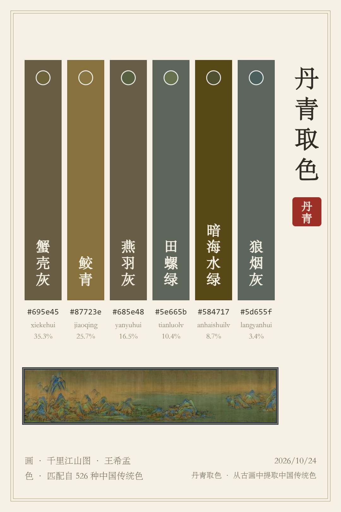
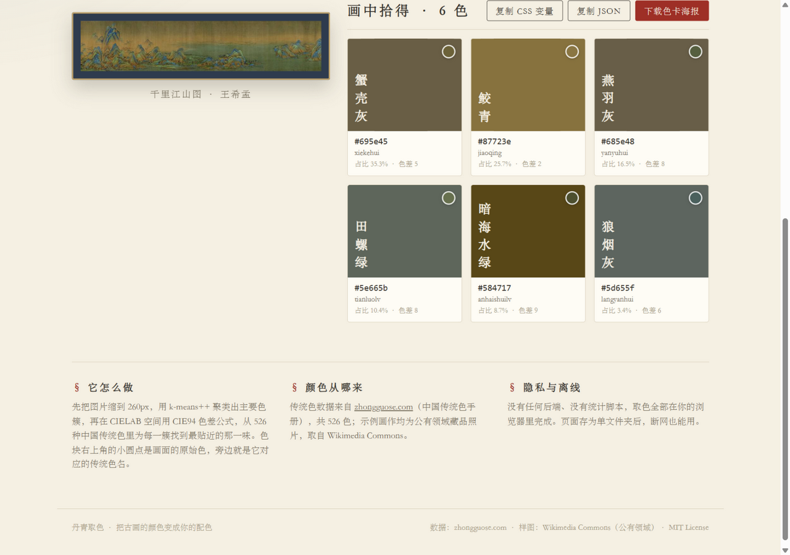

# 丹青取色

**从古画里，取一抹中国传统色。**

上传任意一幅古画（或任何图片），自动提取画面主色，并从 **526 种中国传统色**（天水碧、海天霞、缃叶、窃蓝……）中为每一种找到最贴近的那一味，生成可分享的色卡海报，一键导出 CSS 变量。

**在线使用：https://cchichi.github.io/danqing-palette/** （无需安装，打开即用，图片不上传服务器）



## 它能做什么

- **三种方式上传**：拖拽、Ctrl+V 粘贴、点击选择，也可以直接点内置示例（《千里江山图》《富春山居图》《瑞鹤图》《溪山行旅图》，均为公有领域藏品照片）
- **传统色匹配**：k-means++ 聚出主色后，在 CIELAB 空间用 CIE94 色差公式匹配 526 种传统色，色名不重复（占用时自动让给次近的色）
- **原始色对照**：每个色块右上角的小圆点是画面的原始色，一眼看出「画里的颜色」和「色卡名字」的关系
- **色卡海报**：一键生成 1080×1620 竖版海报（色带 + 竖排色名 + 朱印 + 原画小样），适合分享到朋友圈 / 小红书
- **导出**：CSS 自定义属性（`--蟹壳灰: #695e45;` 中文变量名，合法且好记）与 JSON，供设计 / 前端直接取用
- **纯本地**：没有后端、没有统计脚本，断网后把文件夹存下来也能用；同一张图每次取色结果一致（固定随机种子）



## 原理

1. 图片缩到最长边 260px，收集不透明像素；
2. k-means++（k=8，固定种子）迭代出主要色簇，CIELAB 色差小于 5 的簇合并，保留占比前 6 的颜色；
3. 每一簇在 CIELAB 空间用 CIE94 公式对 526 种传统色做**独占最近邻**匹配（按占比从大到小认领，色名不重复）；
4. 色卡海报用 Canvas 2D 绘制导出。

全部代码无依赖、无构建，`index.html` + 原生 JS 共约 700 行。

## 本地运行

无需构建，任选其一：

```bash
# 直接双击 index.html 也可以（示例图已内嵌为 base64）
# 或者起个静态服务器：
npx serve .
# 或
python -m http.server
```

## 数据与图片来源

- 中国传统色数据（526 色）：[zhongguose.com 中国传统色手册](https://zhongguose.com)
- 示例画作：Wikimedia Commons 公有领域藏品照片 —— 王希孟《千里江山图》、黄公望《富春山居图》（剩山图）、赵佶《瑞鹤图》、范宽《溪山行旅图》
- 灵感：《中国传统色》系列图书与「中国色」网站

## License

MIT
